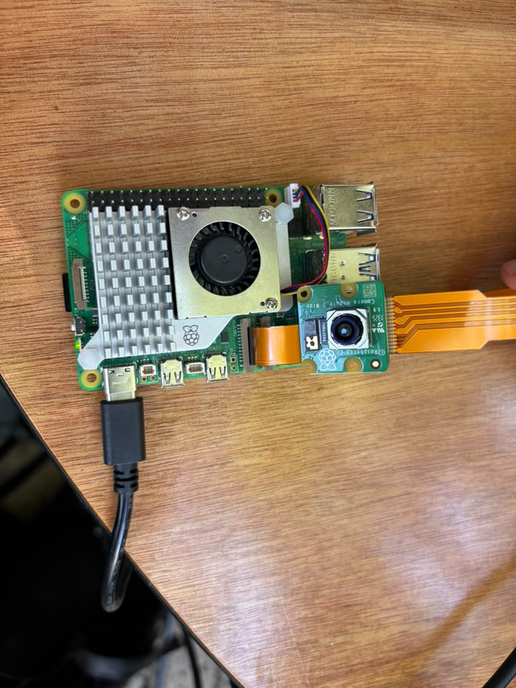
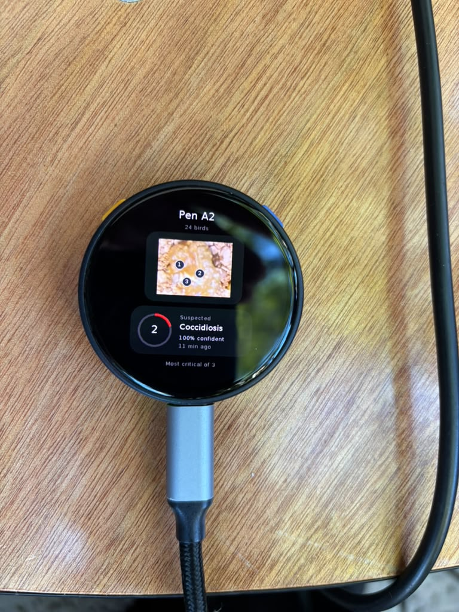
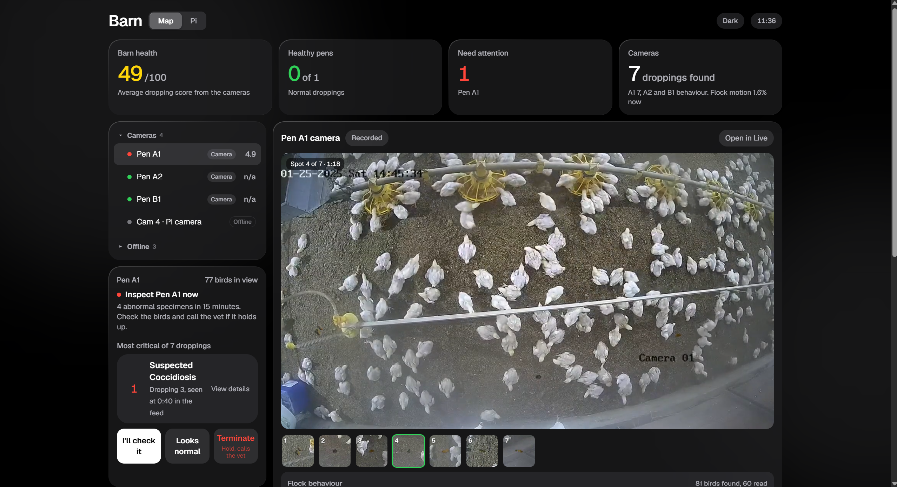
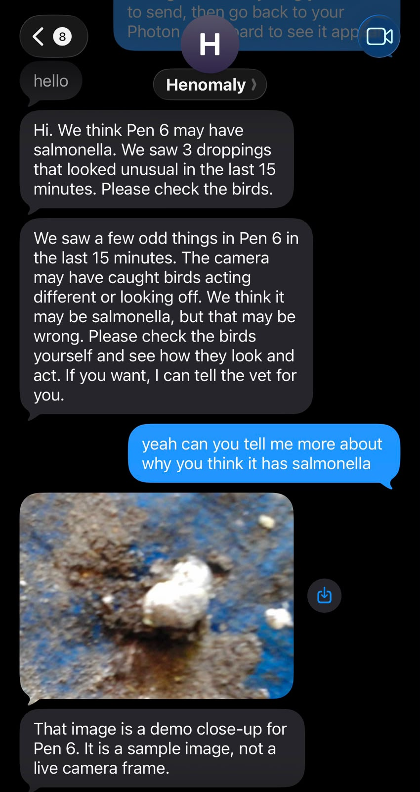
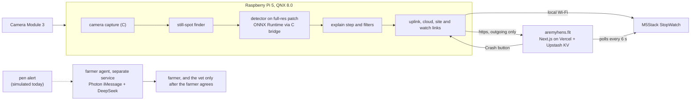
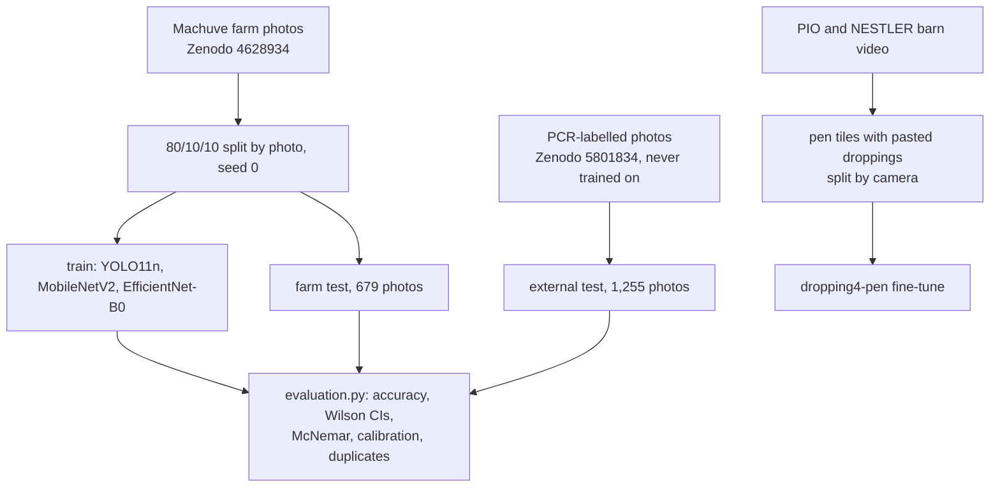

# Holy-Crap

A pen camera, a QNX Raspberry Pi 5 and a detector that look at chicken droppings and tell a farmer when a pen needs a look. It flags appearance for review. It does not diagnose disease and never decides on treatment or culling.

Live site: https://aremyhens.fit (dashboard, Pi status, privacy and terms)

| Raspberry Pi 5 with Camera Module 3 | Watch | Dashboard | Farmer chat |
|---|---|---|---|
|  |  |  |  |

The dashboard reads the analysed recorded clips. Test droppings were pasted into the Pen A1 clip at known times. The watch photos were taken with an earlier demo data stream, and the chat photo is a sample image.

## Paper

**Held-out Accuracy Is Not New-Collection Accuracy: A Cross-Collection Benchmark of Poultry Dropping Classifiers and a Process-Isolated Pen-Camera Pipeline on a QNX Raspberry Pi 5.** Deekshith Reddy Bhoomireddy, Rishit Rai, Lance Streuber.

[PDF](paper/holy-crap-paper.pdf) · [single LaTeX file](paper/holy-crap-paper.tex) · [sections](paper/sections/) · [references](paper/references.bib) · [citation check](paper/citation-check.md) · [verification report](paper/verification-report.md)

Every model trained on the same split of the Machuve farm photos scores about 99% on the farm test and 75 to 78% on a separate PCR-labelled collection.

| Model, same training photos | Farm test (679) | PCR-labelled (1,255) |
|---|---|---|
| MobileNetV2 (Machuve et al.) | 99.6% | 74.6% |
| EfficientNet-B0 (Dhungana et al.) | 99.0% | 78.2% |
| YOLO11n detector (ours), always answers | 98.5% | 76.3% |

Other findings:
- 49 farm test photos are exact copies of training photos. Removing them changes accuracy by 0.1 points.
- 19 pairs of identical PCR files are filed under two classes.
- In the farm set, the salmonella and Newcastle photos come from inoculated birds, so the setting can stand in for the class.
- A pen-scale fine-tune, trained on public barn video with pasted droppings and split by camera, lifts recall from 0.29 to 0.80 and precision from 0.11 to 0.93 on unseen cameras.
- On QNX, a pipeline stage killed with `SIGKILL` is relaunched within 20 to 33 ms of the supervisor noticing.

Build the PDF: `python paper/build.py --tectonic <path to tectonic>`, or upload `paper/` to Overleaf. The figures come from [data-visualization/evaluation.py](data-visualization/evaluation.py).

## How it fits together

Each box inside the Pi is its own QNX process with its own priority. Stages exchange small messages by QNX message passing, and full frames stay in shared memory. A supervisor relaunches any stage that exits. The site link only makes outgoing requests, so the Pi works behind any Wi-Fi. The farmer agent sends an alert over iMessage, answers questions in plain words, and contacts the vet only after the farmer clearly agrees, a rule enforced in code, not by the language model. It is not yet fed by the Pi.

## Repository

| Path | What it is |
|---|---|
| [paper/](paper/) | the paper, its references and verification |
| [data-visualization/](data-visualization/) | two audit notebooks, `evaluation.py`, every figure as PNG, SVG, PDF and CSV |
| [models/](models/) | detector weights (close-up, pen-scale, Veri replicate, behaviour) with test metrics |
| [training/](training/) | data prep, detector and pen training, `benchmark_classifiers.py` |
| [target/qnx/edge/](target/qnx/edge/) | the Pi pipeline: sections, supervisor, C camera capture, ONNX bridge, autostart |
| [target/qnx/upstream/](target/qnx/upstream/) | draft fixes for QNX's ONNX Runtime package |
| [app/console/](app/console/) | the dashboard and Pi page (Next.js), deployed at aremyhens.fit |
| [app/watch/](app/watch/) | StopWatch firmware |
| [app/farmer-agent/](app/farmer-agent/) | Photon iMessage farmer and vet agent |
| [app/live-feed/](app/live-feed/) | clip fetching and offline analysis behind the dashboard camera view |
| [dataset/grading/](dataset/grading/) | appearance grades for the 1,255 PCR photos |
| [src/](src/), [web/](web/) | simulation lab API and UI |
| [docs/](docs/) | design notes, research base, QNX notes, change log |

## Run it

| What | Command |
|---|---|
| Dashboard | `cd app/console && npm install && npm run dev`, then open http://localhost:3000 |
| Figures and notebooks | `cd data-visualization && pip install -r requirements.txt && python evaluation.py` |
| Baseline benchmark | `python training/benchmark_classifiers.py all` (needs the photo zips from `audit_images.py` and a CUDA PyTorch) |
| Farmer agent, mock mode | `cd app/farmer-agent && npm install && cp .env.example .env.local && npm run simulate` |
| Watch | copy `app/watch/console/secrets.example.h` to `secrets.h`, then flash with `arduino-cli` (see [app/watch/](app/watch/)) |
| Pi pipeline | see [TARGET.md](TARGET.md) and [docs/qnx-microkernel.md](docs/qnx-microkernel.md). It starts at boot through `install_autostart.sh` |
| Simulation lab | `make bootstrap && make dev`, then open http://127.0.0.1:5173 ([usage notes](docs/architecture/simulation-lab-usage.md), [architecture](docs/architecture/simulation-lab.md)) |

Secrets (Wi-Fi, site tokens, API keys) never go in the repository. They live in `secrets.h`, `.env.local` and `~/hc-site.json` on the Pi.

## Data and licences

Machuve et al. farm and PCR photos (Zenodo 4628934, 5801834), PIO broiler videos (Zenodo 16686320) and NESTLER poultry videos (Zenodo 15063494) are CC BY 4.0. Big Broiler clips and the behaviour models trained on them are AGPL-3.0. Sources and checks are in [paper/citation-check.md](paper/citation-check.md).

Our code, models and results are released under the [AGPL-3.0](LICENSE). Cite with [CITATION.cff](CITATION.cff).

Built at LA Hacks with the QNX and Veri tracks.
