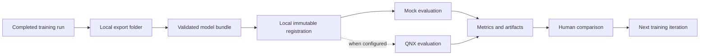

# Model lifecycle for simulation

This document covers the handoff after training is complete. The teammate who
owns model training also owns Veri compute, training configuration, credentials,
and export. The simulation lab starts with a completed model artifact on local
disk.

## The handoff



The Veri API and CLI are external and may change. Version 1 does not call them,
submit hosted jobs, allocate compute, or store credentials. It imports a
completed local export folder selected by the teammate running the lab.

## Model bundle

A model bundle contains:

```text
candidate-model/
  model.json
  model.tflite             # or model.onnx
  labels.json              # optional when labels are inline in model.json
  README.md                # optional notes from the training owner
```

`model.json` must satisfy
[`contracts/model-bundle.schema.json`](../../contracts/model-bundle.schema.json).
It records preprocessing, output meaning, provenance, reported training metrics,
and runtime compatibility. It must not contain access tokens, private URLs with
embedded credentials, SSH material, or secrets copied from a training service.

Training provenance is useful, but simulation registration does not require a
specific provider. A locally trained and a Veri-exported artifact use the same
bundle contract.

## Identity and immutability

The model file's SHA-256 digest is its content identity. Registration calculates
the digest instead of trusting a filename. The digest in `model.json` must match
the bytes being imported.

`name` and `version` are human handles. They do not establish identity by
themselves. If any of these change, register a new bundle:

- model bytes;
- label order;
- input size, layout, type, or normalization;
- output interpretation;
- quantization or runtime compatibility.

The catalog never overwrites an existing digest. Reusing a semantic version for
different bytes is an error because it makes old run results ambiguous.

## Local registration

Registration is complete only when it performs these checks before making a
model selectable for a real executor:

1. Parse and validate `model.json`.
2. Resolve `model_file` relative to the chosen bundle directory.
3. Reject a path that escapes that directory.
4. Accept only the declared TFLite or ONNX format.
5. Calculate SHA-256 and compare it with the manifest.
6. Copy the artifact into content-addressed local storage.
7. Write immutable catalog metadata with its registration time.

The local-directory importer enforces these checks. The dashboard also offers a
single-file upload so the team can exercise a candidate in mock runs before its
bundle metadata is ready. That upload hashes and stores the file, but it does
not validate preprocessing, output interpretation, or target-runtime
compatibility. Do not treat a single-file upload as QNX-ready.

A Veri import is not a special model type. It is a convenience for pointing the
same bundle importer at a local completed-output directory.

## Evaluation

### Mock executor

The mock proves the experiment plumbing before a target runtime is available.
It produces repeatable pen truth, simulated predictions, alert timing, false
alerts, and execution metrics. It does not load or judge the real model bytes,
so its results must be labeled `mock` in the UI and exports.

### QNX executor

The QNX adapter will replay deterministic frames through the physical
Raspberry Pi 5 and collect measured inference results. Until target file-camera
playback and runtime compatibility are implemented and tested, the capability
must report `not_configured` and refuse to run.

QNX compatibility is a property of a specific artifact, not an assumption from
the `.tflite` extension. A target-ready bundle should record the runtime and
version used for conversion, supported input types, quantization, and any
required delegates or operators.

## Results returned to training

Every completed run links to exact model and scenario hashes. The useful handoff
back to the training teammate is a small, inspectable result bundle containing:

- detection delay when the hidden scenario has an onset;
- false-alert count and whether the run alerted;
- mean achieved FPS, p95 inference latency, and dropped frames;
- timeline and snapshots used to explain the aggregate numbers;
- executor name/version and artifact hashes;
- a failure record when evaluation could not complete.

These results inform the next training iteration. They do not automatically
start it. Automated Veri job submission can be considered after local import,
evaluation, and artifact retention are stable.

## Version changes

Use a new model version whenever bytes or runtime behavior change. A practical
pattern is:

1. training owner exports `pen-anomaly` version `0.3.0`;
2. simulation owner registers it and runs the fixed scenario suite;
3. team compares it with `0.2.0` using saved run results;
4. training owner changes data or training and exports `0.3.1`;
5. both versions remain registered so the comparison is reproducible.

Delete only disposable local copies after verifying their digest exists in the
team's chosen artifact storage. Git keeps manifests and contracts, not the
large model files.
