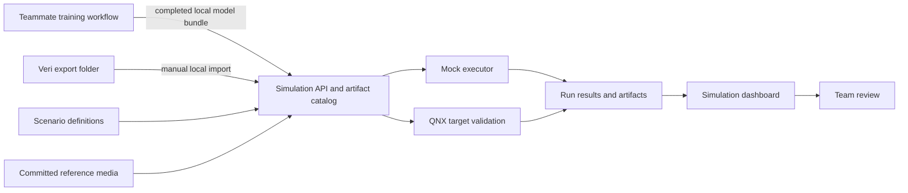
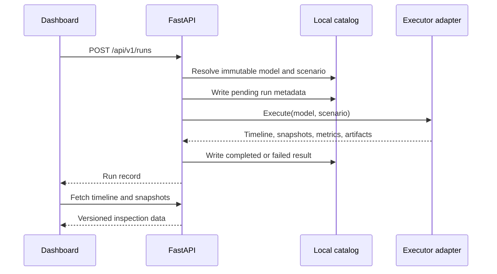

# Simulation lab architecture

## What this system is for

The simulation lab gives the team one repeatable way to inspect a whole-pen
video and test model handoffs before we put them in the camera loop on the QNX
Raspberry Pi.

The operator unit is one video, not one chicken and not a simulated outbreak.
A clip assessment summarizes the entire recording with pen-level activity,
flock appearance, feces candidates, and a feces-class distribution. It does not
try to maintain bird identities through occlusion. It also does not turn a
short recording into an infection-progression story.

The lab evaluates observable anomalies and alert behavior. It does not model a
veterinary diagnosis, and its output must not be presented as one. A scenario
may contain a hidden `outbreak` state so that we can measure detection delay,
but the operator-facing result is still a pen or group anomaly for human
review.

Version 1 registers model bundles, assesses whole-pen video, and keeps every
real-versus-simulated handoff visible. Activity, flock appearance, and feces
locations are currently deterministic adapters. Curated real feces photos are
substituted after location selection and run through the committed ONNX model.

## Current implementation status

The first scaffold includes the local API, catalog, mock executor, dashboard,
clip assessment pipeline, and a completed-output importer. The local-directory importer validates the
versioned model-bundle contract, the referenced model path, its format, and its
SHA-256 digest. The simpler browser upload registers one model file for mock
runs; it is a development convenience, not a validated deployment bundle.

The QNX Pi is wired as an honest target-validation boundary, not an inference
executor. The Pi has no TensorFlow Lite, ONNX, OpenCV, or NumPy runtime, so a
QNX run stages one exact catalog model blob and one canonical scenario JSON
onto the Pi, runs the dependency-free `target/qnx/simlab_probe.py` worker
through the persistent runner, and stores the verified receipt plus the helper
log under the run directory (`evaluation_kind: target_probe`,
`inference_performed: false`, metrics null, no timeline or snapshots). A failed
QNX run stays in run history as failed.

EMULSION disease simulation and BlenderProc rendering are not implemented.

### QNX realtime boundary

QNX is the reliability boundary for the eventual camera loop, not a source of
better model predictions. The target design separates fixed-priority capture,
budgeted lower-priority inference, and pen-assessment publishing into different
processes. QNX `SCHED_SPORADIC` can cap inference execution at its normal
priority so overload delays or drops model work instead of starving capture;
HAM can later detect a dead or unresponsive worker and restart it. Hardware
watchdog recovery and QNX kernel traces are later proof gates.

None of those realtime controls is currently configured. The physical Pi now
proves QNX 8.0.0 target execution, artifact/scenario hash validation, and a
separate native NCNN experiment with the final 320x320 model. The general
dashboard executor remains probe-only and reports `inference_performed: false`.
Dashboard telemetry labels each feature as verified, OS-supported only,
planned, or unsupported and does not imply a deadline guarantee before an
overload test measures one.

QNX OS 8.0 does **not** support the Adaptive Partitioning Scheduler. The
architecture must not claim APS or adaptive CPU partitions. See
[QNX realtime architecture](qnx-realtime.md) for the supported scheduling and
recovery design, dashboard proof fields, current evidence boundary, and
official QNX sources.

### Whole-pen clip assessment

`POST /api/v1/clip-assessments/upload` accepts one multipart video. The service
checks its plain filename, declared media type, extension, container signature,
and configured byte limit before installing it in a content-addressed path
under `.simlab/clips/blobs/`. Installation uses a staged file, `fsync`, and an
atomic rename. Existing bytes are never overwritten. `ffprobe` supplies
duration, dimensions, and frame rate when it is available; missing or invalid
metadata is reported as unavailable instead of failing the assessment.

`POST /api/v1/clip-assessments/demo/{asset_id}` runs the same pipeline against
an installed demo video after the demo manifest's SHA-256 has been verified.
The read endpoints are:

- `GET /api/v1/clip-assessments`
- `GET /api/v1/clip-assessments/{id}`
- `GET /api/v1/clip-assessments/{id}/content`

Version 1 has four replaceable adapters:

| Adapter | Current input | Current output | Real artifact |
|---|---|---|---|
| Pen activity | One whole-pen clip | Clip-average score, category, motion coverage, and zone scores | Not configured |
| Flock appearance | Sampled frames from the clip | One clip-average appearance score and review category | Not configured |
| Feces candidate detector | Sampled frames from the clip | Timestamped normalized boxes and lazy crop references | Not configured |
| Feces disease classifier | One curated proxy specimen, letterboxed RGB 320 x 320 | Coccidiosis, Healthy, New Castle Disease, or Salmonella | Committed YOLO11n ONNX model |

The first three adapters derive repeatable mock values from the video SHA-256.
For each candidate, a demo profile deterministically selects a real, attributed
feces photo from `proxy-specimens/`. That proxy photo did not come from the
video, and the UI labels it as simulated input. The committed YOLO11n ONNX
model then performs the actual appearance classification. The expected dataset
class is displayed separately and never replaces the model prediction. If the
runtime, model, photo, or checksum is unavailable, the classifier falls back
to an explicitly marked deterministic mock.

The feces classifier was trained from the
[Chicken Disease dataset](https://www.kaggle.com/datasets/allandclive/chicken-disease-1/data).
The repository's proxy photos are instead small, attribution-preserving
derivatives of the CC BY 4.0 Poultry Diseases Dataset published by Machuve et
al. on Zenodo. Their committed manifests record source, license, SHA-256, and
the demo-only expected class.

## System context



Training compute and training code are owned by the model-training workstream.
Veri credentials, hosted job submission, and compute allocation are outside
this repository's simulation scope. The only Veri boundary in version 1 is a
local folder produced by a completed training job.

## Components

### Simulation API

The FastAPI service is the control plane. It creates runs, invokes an executor
adapter, and serves run data to the dashboard. It will also enforce the model,
scenario, and run-result schemas as the contract layer is connected. The API
owns orchestration, not inference implementation details.

### Artifact catalog

The catalog is a local filesystem store rooted at `HOLY_CRAP_HOME` (default
`.simlab`). It holds metadata as JSON and large payloads as content-addressed
files. This is enough for the hackathon and keeps a run inspectable without a
database server.

Metadata is append-oriented. A model file or scenario with a known SHA-256
digest is immutable. Register a new version instead of replacing bytes under an
existing identity. Writes use a temporary file followed by an atomic rename so
a stopped process does not leave half-written metadata.

### Executor adapters

An executor accepts resolved model and scenario records and returns the
versioned run-result contract.

- `mock` is the working version 1 executor. It generates deterministic pen
  state and noisy predictions from a fixed seed. Its results are
  `evaluation_kind: prediction`.
- `qnx` performs target validation only. The Pi has no inference runtime, so a
  QNX run proves one exact model blob and one canonical scenario JSON reached
  the physical target and were processed there; the run result is
  `evaluation_kind: target_probe` with null metrics, an empty timeline, and
  receipt/log artifacts. QNX never claims predictions.
- Future workstation adapters can replay real video or consume rendered frames
  without changing the API used by the dashboard.

Target validation and inference are different jobs with different honesty
rules. A target probe reports `inference_performed: false` and refuses receipts
that claim otherwise; measured inference on the Pi is a separate future
executor that can only appear once a real runtime exists on the target.

Capability status follows a strict ladder:

| Status | Meaning |
|---|---|
| `ready` | Adapter fully works (mock). QNX can never reach this until actual inference exists on the Pi. |
| `probe_only` | QNX transport works (SSH, Python, persistent runner), so target validation runs can complete; no inference. |
| `unreachable` | QNX transport failed or timed out during an active probe. |
| `runtime_missing` | QNX is reachable but Python or the persistent runner is missing, so the probe worker cannot run. |
| `not_configured` | `QNX_EXECUTOR_MODE` is disabled; no Pi contact is attempted. |

`GET /api/v1/system/capabilities` and `POST /api/v1/system/qnx/probe` may
actively probe the Pi, but only with short timeouts, and always return a state
rather than throwing. Unsupported executors never silently fall back to the
mock.

### Simulation dashboard

The React/Vite dashboard is a lab console. It selects a model, scenario, and
executor; starts a run; renders a top-down pen state; scrubs the timeline; and
compares hidden simulation truth with model predictions. It also shows current
capabilities so a teammate can tell the difference between working code and a
planned adapter.

The top-down view is an inspection tool, not a claim that mock geometry looks
like camera footage. Real-image replay and 3D rendering will supply separate
frame artifacts later.

### Reference media

`demo-assets/` commits small JSON manifests for real-camera reference media:
the four-frame PIO overhead broiler-house montage and the team-reviewed
Spatiotemporal Annotator whole-pen clip. Both are CC BY 4.0 with source and
attribution recorded. The clip is a real 19.4-second, 848 x 480, 5 fps overhead
view of 40 week-one birds in two complete pens. The binaries themselves are not
committed; `make demo-assets` fetches every manifest into the runtime home and
verifies both exact byte size and SHA-256 before install. Pass an asset id to
`scripts/fetch_demo_assets.py` to fetch only one.

The fetcher keeps HTTPS certificate verification enabled. On macOS it falls
back from Python's configured OpenSSL bundle to `/etc/ssl/cert.pem` and common
Homebrew bundle paths. A custom trusted bundle can be supplied with `--ca-file`
or `HOLY_CRAP_CA_FILE`; a missing explicit bundle is an error rather than a
reason to disable verification.

The media API serves typed metadata (`GET /api/v1/media`) and content
(`GET /api/v1/media/{asset_id}/content`) only when the installed file exists
and its bytes match the committed digest, using strictly validated plain-file
paths under the runtime home. Installed state, source URL, dataset URL, DOI,
license, attribution, creators, and limitations travel with every asset.

Dataset composition boundary: reference media is a visual backdrop, not a
measurement. In `pio-reference-100` the recorded image is explicitly
non-aligned with the simulated birds, and outbreak timing and positions are
simulated. The whole-pen clip has activity labels available in its source
package but no disease labels, and this dashboard asset is the raw video only.
Neither source is outbreak footage and neither is labeled as one.

## Run data flow



A normal version 1 run follows this path:

1. A teammate imports a validated model bundle from a completed local export
   folder, or uses the single-file upload for a mock-only experiment.
2. The API hashes every model file. Bundle import also validates the full
   manifest before registration.
3. The teammate chooses a deterministic scenario such as `healthy-100`,
   `outbreak-100`, or `pio-reference-100`.
4. The executor writes sampled truth, predictions, timing, and alert state.
5. The API stores the immutable references and calculated metrics.
6. The dashboard reads the saved result. Reloading the page does not rerun the
   experiment.

A QNX run follows the same store-first discipline but produces a target probe,
not predictions: the run metadata is written first, the exact catalog model
blob and canonical scenario file are staged to the Pi, the probe worker
verifies their hashes there, and the receipt and helper log land in the run
directory. The Pi's clock may be unset after boot, so the user-facing result
uses host-side UTC timestamps. The untouched receipt remains the source for
raw target timestamps, including an epoch value when that is what QNX
reported. Any transport failure leaves the run recorded as failed.

## Repository layout

The simulation additions use these top-level paths:

```text
contracts/                 Versioned interchange schemas
scenarios/                 Committed deterministic scenario definitions
dataset-clips/             Human-reviewed video/image catalog metadata
src/holy_crap_simlab/      API, catalog, adapters, mock engine, media, and CLI
target/qnx/                Committed stdlib-only QNX probe worker
demo-assets/               Committed reference-media manifests (binaries fetched)
tests/                     API, contract, catalog, and determinism tests
web/                       React/Vite simulation dashboard
docs/architecture/         Current system and model handoff
docs/decisions/            Architecture decision records
docs/roadmap/              Ordered implementation gates
scripts/                   Local development and environment checks
```

Generated models, videos, renders, run outputs, and `.simlab/` do not belong in
Git. Commit their small manifests and SHA-256 digests. Put large shared
artifacts in agreed external storage or a GitHub release.

## Reviewed clip library

`dataset-clips/reviewed.json` is the dashboard's source of truth for camera
fit, review verdicts, source links, license notes, and whether an entry is
appropriate for the aggregate clip workflow. The API adds local install state
at request time. A verified demo asset gets a playable content URL, and the
safe local dataset-video store (`<home>/datasets/videos/**`,
`HOLY_CRAP_DATASET_VIDEOS_DIR` override) matches reviewed entries by their exact
file name, recursively. When that file is installed, the entry reports
`bytes_available`, its installed byte size, and a same-origin
`/api/v1/dataset-clips/{id}/content` URL. Unsafe names, paths that escape the
configured root, and ambiguous duplicate file names are rejected, never
guessed. Installed reference-only and rejected entries are previewable but
remain non-assessable. Installed, assessable catalog entries run the bounded
real-video pipeline and record `source: dataset`. Assessable entries with no
local bytes use the deterministic catalog fallback instead.

The catalog endpoint supports both cases. With installed bytes, it hashes and
hard-links the video into content-addressed storage, samples real frames, and
runs the configured behavior, pen-dropping, and close-up models. Without bytes,
its stable fallback seed comes from canonical catalog metadata rather than
pretend footage. Fallback records use `source: catalog_mock`,
`bytes_available: false`, a null content URL, and an explicit warning that no
video was decoded and no model ran. Reference-only, rejected, and image-only
entries are never assessable.

## Runtime boundaries

The runtime split is intentional:

| Runtime | Owns | Does not own |
|---|---|---|
| Mac or workstation | API, dashboard, catalog, scenario generation, rendering, result comparison | QNX camera drivers |
| QNX Raspberry Pi 5 | Camera capture and measured target inference | Web UI, Blender rendering, model training |
| Training workstream | Data preparation, training, evaluation, export | Simulation orchestration, Pi connectivity |
| Veri | External training/export environment managed by the training workstream | Local catalog state or simulation credentials |

The Pi is headless and reached through `qnxpi`. Short target commands use SSH;
long jobs use the existing persistent runner. The simulation scaffold does not
modify `/boot/onboot`, the Railway tunnel, or target credentials.

## Why rendering is separate from execution

Rendering and execution have different jobs. A renderer produces observations:
mock state, recorded frames, or synthetic RGB and annotations. An executor
measures how a particular model/runtime consumes those observations. Keeping
them separate lets us:

- reuse one scenario across a browser preview, workstation inference, and QNX
  playback;
- compare synthetic and recorded observations without rewriting run storage;
- render offline at higher quality than the Pi could sustain;
- measure the Pi at its actual target rate, around 11 FPS, without asking it to
  generate the test scene too;
- replace BlenderProc or the disease-progression model later without changing
  the dashboard contract.

The renderer metadata in a scenario records how observations were produced.
It is not an executor selection.

## Reproducibility

A result is reproducible only when it records all of these inputs:

- exact model SHA-256 and model-bundle metadata;
- exact scenario SHA-256, seed, and schema version;
- executor name and version;
- requested FPS and duration;
- timestamps, status, metrics, and artifact digests;
- repository commit when available.

Two mock runs with the same resolved inputs must generate the same truth and
prediction timeline. Wall-clock timestamps and run IDs may differ. Real-device
runs also record measured timing because thermal state, I/O, and runtime
versions can change performance even when the input bytes match.

## Security and data handling

- Never put SSH keys, Wi-Fi credentials, Veri tokens, model-service tokens, or
  browser authentication state in this repository or model metadata.
- Treat imported bundles as untrusted input. Validate paths, reject references
  outside the selected import folder, limit upload size, and calculate hashes
  locally.
- Do not execute scripts from an imported model bundle. Version 1 imports data
  files and metadata only. The only remote code executed is the committed,
  stdlib-only probe worker shipped from this repository.
- Bind development services to loopback by default. Network exposure requires a
  separate decision about authentication and transport security.
- Serve reference media only after the manifest digest verifies the file bytes,
  and only through safe plain-file path resolution (no traversal, no nesting).
- Preserve source and license metadata for datasets, videos, textures, and 3D
  assets. A usable file is not automatically a redistributable file.
- Keep animal and farm footage access-controlled. Strip location or operator
  identifiers from demo artifacts unless they are needed and approved.

## Contract ownership

The JSON schemas in `contracts/` are the integration boundary. A pull request
that changes required fields or meaning must update the schema version,
fixtures, API validation, UI types, and this documentation together. At least
one teammate outside the authoring workstream should review that change.
