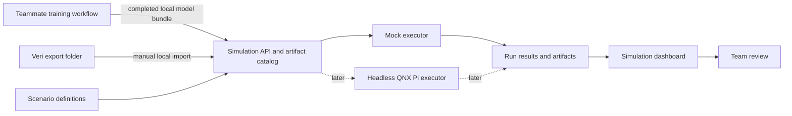
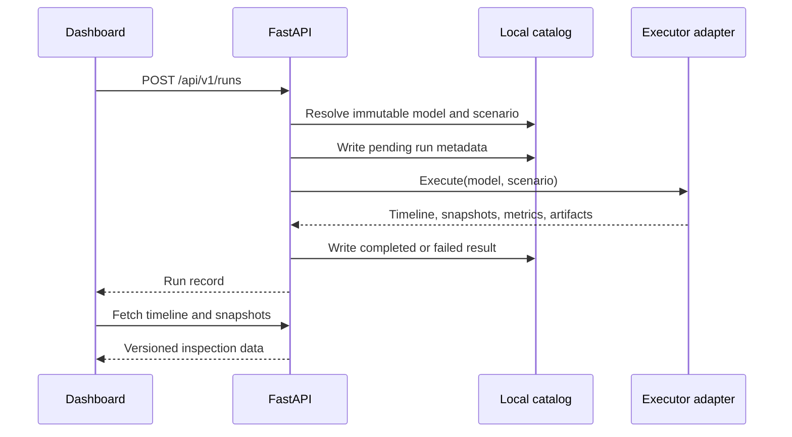

# Simulation lab architecture

## What this system is for

The simulation lab gives the team one repeatable way to answer a practical
question: how does a candidate model behave on a pen-level scenario before we
put it in the camera loop on the QNX Raspberry Pi?

The lab evaluates observable anomalies and alert behavior. It does not model a
veterinary diagnosis, and its output must not be presented as one. A scenario
may contain a hidden `outbreak` state so that we can measure detection delay,
but the operator-facing result is still a pen or group anomaly for human
review.

Version 1 is deliberately narrow. It registers a completed local model bundle,
runs deterministic mock scenarios, and shows truth beside predictions in a
browser. Real video, synthetic rendering, epidemiological simulation, and QNX
playback are later adapters behind the same contracts.

## Current implementation status

The first scaffold includes the local API, catalog, mock executor, dashboard,
and a completed-output importer. The local-directory importer validates the
versioned model-bundle contract, the referenced model path, its format, and its
SHA-256 digest. The simpler browser upload registers one model file for mock
runs; it is a development convenience, not a validated deployment bundle. The
QNX executor, real-video replay, EMULSION model, and BlenderProc renderer are not
implemented.

## System context



Training compute and training code are owned by the model-training workstream.
Veri credentials, hosted job submission, and compute allocation are outside
this repository's simulation scope. The only Veri boundary in version 1 is a
local folder produced by a completed training job.

## Components

### Simulation API

The FastAPI service is the control plane. It creates runs, invokes an executor
adapter, and serves run data to the dashboard. It will also enforce the model,
scenario, and run-result schemas as the contract layer is connected. The API
owns orchestration, not inference implementation details.

### Artifact catalog

The catalog is a local filesystem store rooted at `HOLY_CRAP_HOME` (default
`.simlab`). It holds metadata as JSON and large payloads as content-addressed
files. This is enough for the hackathon and keeps a run inspectable without a
database server.

Metadata is append-oriented. A model file or scenario with a known SHA-256
digest is immutable. Register a new version instead of replacing bytes under an
existing identity. Writes use a temporary file followed by an atomic rename so
a stopped process does not leave half-written metadata.

### Executor adapters

An executor accepts resolved model and scenario records and returns the
versioned run-result contract.

- `mock` is the working version 1 executor. It generates deterministic pen
  state and noisy predictions from a fixed seed.
- `qnx` is a capability stub until file-camera playback and the target runtime
  have been proven on the Pi.
- Future workstation adapters can replay real video or consume rendered frames
  without changing the API used by the dashboard.

Unsupported executors report `not_configured`; they do not silently fall back
to the mock.

### Simulation dashboard

The React/Vite dashboard is a lab console. It selects a model, scenario, and
executor; starts a run; renders a top-down pen state; scrubs the timeline; and
compares hidden simulation truth with model predictions. It also shows current
capabilities so a teammate can tell the difference between working code and a
planned adapter.

The top-down view is an inspection tool, not a claim that mock geometry looks
like camera footage. Real-image replay and 3D rendering will supply separate
frame artifacts later.

## Run data flow



A normal version 1 run follows this path:

1. A teammate imports a validated model bundle from a completed local export
   folder, or uses the single-file upload for a mock-only experiment.
2. The API hashes every model file. Bundle import also validates the full
   manifest before registration.
3. The teammate chooses a deterministic scenario such as `healthy-100` or
   `outbreak-100`.
4. The executor writes sampled truth, predictions, timing, and alert state.
5. The API stores the immutable references and calculated metrics.
6. The dashboard reads the saved result. Reloading the page does not rerun the
   experiment.

## Repository layout

The simulation additions use these top-level paths:

```text
contracts/                 Versioned interchange schemas
scenarios/                 Committed deterministic scenario definitions
src/holy_crap_simlab/      API, catalog, adapters, mock engine, and CLI
tests/                     API, contract, catalog, and determinism tests
web/                       React/Vite simulation dashboard
docs/architecture/         Current system and model handoff
docs/decisions/            Architecture decision records
docs/roadmap/              Ordered implementation gates
scripts/                   Local development and environment checks
```

Generated models, videos, renders, run outputs, and `.simlab/` do not belong in
Git. Commit their small manifests and SHA-256 digests. Put large shared
artifacts in agreed external storage or a GitHub release.

## Runtime boundaries

The runtime split is intentional:

| Runtime | Owns | Does not own |
|---|---|---|
| Mac or workstation | API, dashboard, catalog, scenario generation, rendering, result comparison | QNX camera drivers |
| QNX Raspberry Pi 5 | Camera capture and measured target inference | Web UI, Blender rendering, model training |
| Training workstream | Data preparation, training, evaluation, export | Simulation orchestration, Pi connectivity |
| Veri | External training/export environment managed by the training workstream | Local catalog state or simulation credentials |

The Pi is headless and reached through `qnxpi`. Short target commands use SSH;
long jobs use the existing persistent runner. The simulation scaffold does not
modify `/boot/onboot`, the Railway tunnel, or target credentials.

## Why rendering is separate from execution

Rendering and execution have different jobs. A renderer produces observations:
mock state, recorded frames, or synthetic RGB and annotations. An executor
measures how a particular model/runtime consumes those observations. Keeping
them separate lets us:

- reuse one scenario across a browser preview, workstation inference, and QNX
  playback;
- compare synthetic and recorded observations without rewriting run storage;
- render offline at higher quality than the Pi could sustain;
- measure the Pi at its actual target rate, around 11 FPS, without asking it to
  generate the test scene too;
- replace BlenderProc or the disease-progression model later without changing
  the dashboard contract.

The renderer metadata in a scenario records how observations were produced.
It is not an executor selection.

## Reproducibility

A result is reproducible only when it records all of these inputs:

- exact model SHA-256 and model-bundle metadata;
- exact scenario SHA-256, seed, and schema version;
- executor name and version;
- requested FPS and duration;
- timestamps, status, metrics, and artifact digests;
- repository commit when available.

Two mock runs with the same resolved inputs must generate the same truth and
prediction timeline. Wall-clock timestamps and run IDs may differ. Real-device
runs also record measured timing because thermal state, I/O, and runtime
versions can change performance even when the input bytes match.

## Security and data handling

- Never put SSH keys, Wi-Fi credentials, Veri tokens, model-service tokens, or
  browser authentication state in this repository or model metadata.
- Treat imported bundles as untrusted input. Validate paths, reject references
  outside the selected import folder, limit upload size, and calculate hashes
  locally.
- Do not execute scripts from an imported model bundle. Version 1 imports data
  files and metadata only.
- Bind development services to loopback by default. Network exposure requires a
  separate decision about authentication and transport security.
- Preserve source and license metadata for datasets, videos, textures, and 3D
  assets. A usable file is not automatically a redistributable file.
- Keep animal and farm footage access-controlled. Strip location or operator
  identifiers from demo artifacts unless they are needed and approved.

## Contract ownership

The JSON schemas in `contracts/` are the integration boundary. A pull request
that changes required fields or meaning must update the schema version,
fixtures, API validation, UI types, and this documentation together. At least
one teammate outside the authoring workstream should review that change.
